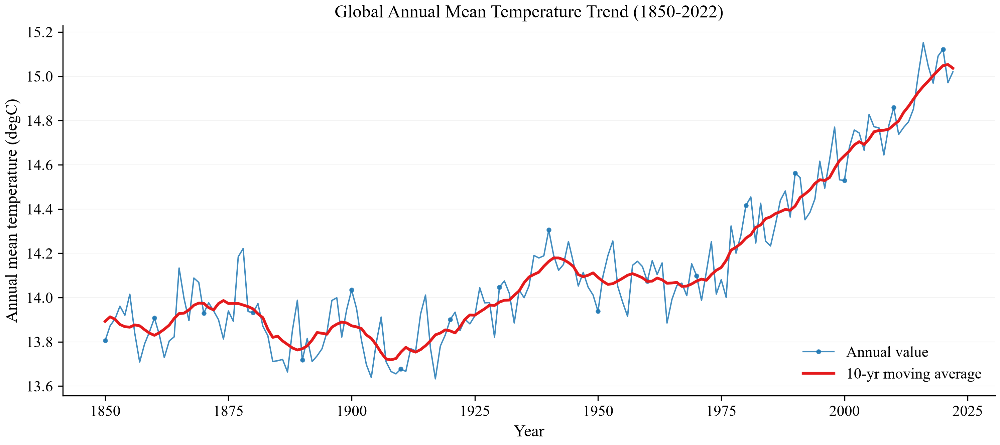
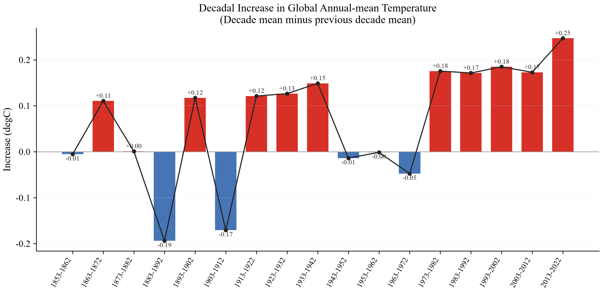

1. 找数据(2022年3月)
2. 算数据
3. 验证结论
4. 根据指标筛选异常值，并进行解释--》得出结论

有没有更适合的全球气温计算方法？【综合考虑到经纬度的】

论文：
1. 目前的趋势分析
2. 评价流程【求指标，比较是否较高】
3. 评价结果
4. 结论说明

> a) 你是否认同"2022 年 3 月全球气温的上升幅度，比此前任何 10 年期间所观测到的增幅都更大"这一说法？请说明理由。

伴随着人类活动，全球温室效应逐年增强，温度逐年攀高，官方公共显示，1950年之后CO2成为了全球增温的主要推动者，在这之后，虽然1950~1970年温度几乎不变，但原因主要在于当时气溶胶锁住的CO2的排放量，待1970年之后，伴随着环境整治运动，气溶胶的下降导致CO2不再被束缚，逸散到大气中，全球气温开始快速上升。其增速远远大于1970年之前的速度。

为了去评估这种增长趋势，我们需要选择合适的指标，在这里我们定义指标：

结果如下，可以发现，在十年窗口期下，我们去使用这套指标去计算全球气温增幅，发现2022年3月这十年，平均气温增长0.25℃。属于历年来最高值，从而可以验证“2022 年 3 月全球气温的上升幅度，比此前任何 10 年期间所观测到的增幅都更大”这一个说法。

